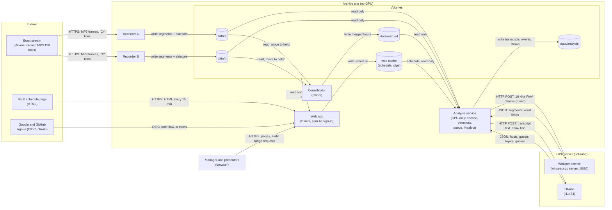
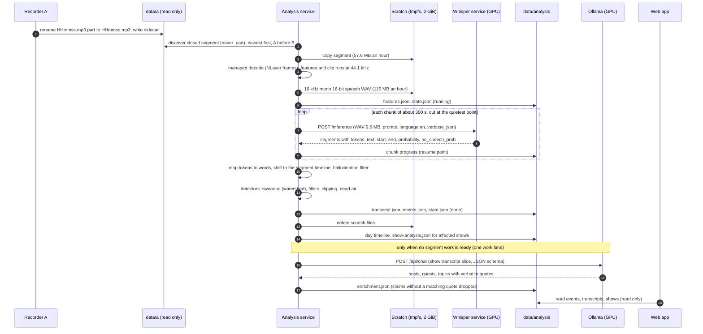
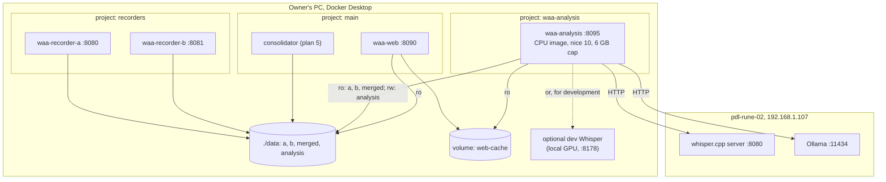
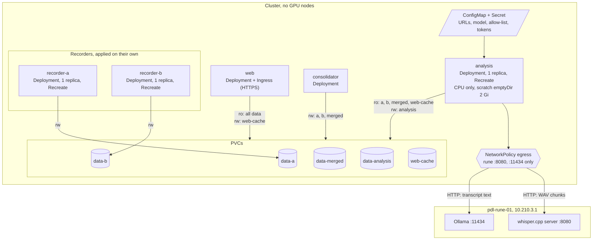
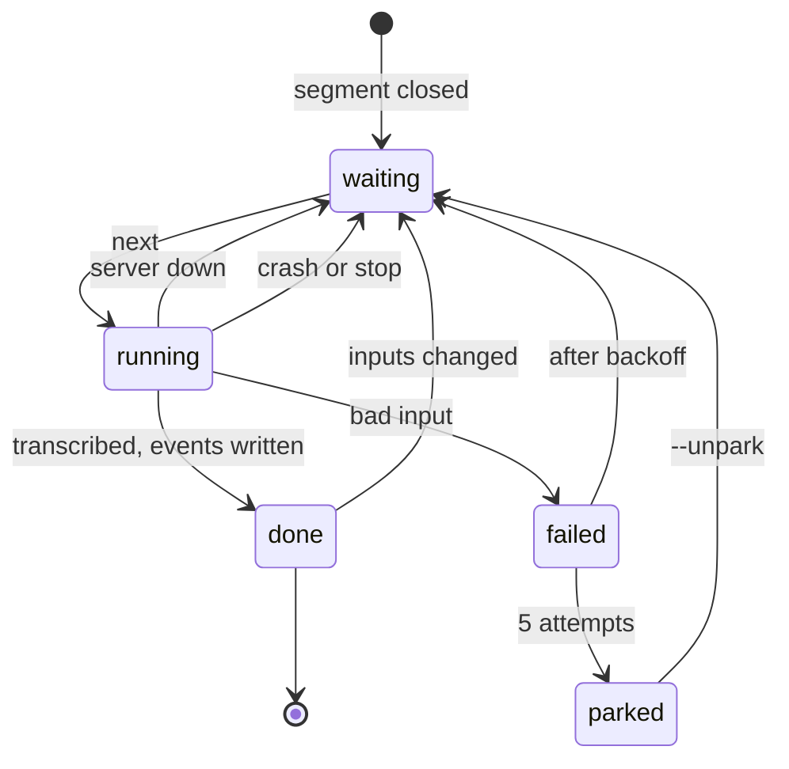
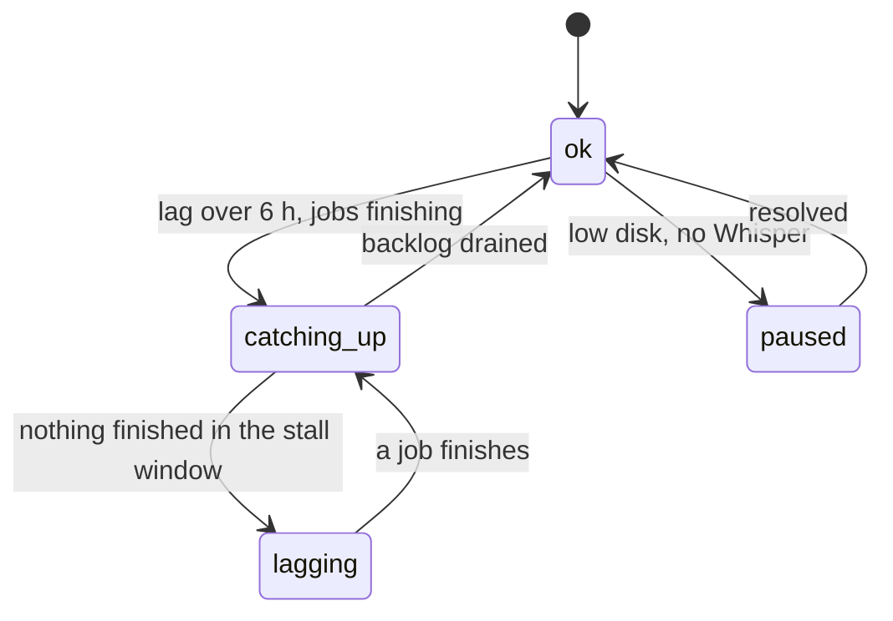

# WebAudioArchive: system design

A ten minute read for a new engineer. It shows how the parts fit together, where each piece runs, what data crosses
which boundary, and why. The detailed requirements are in the spec
(`docs/superpowers/specs/2026-10-15-webaudioarchive-design.md`); the build steps are in the plans
(`docs/superpowers/plans/`). Operating notes: `docs/operations.md` and `docs/analysis.md`. All times are UTC.

Last revised 2026-10-17 (decision D19: speech to text moves to a GPU server; see "Decisions and alternatives
rejected").

## Purpose

Record a web radio station (Burst Radio first) around the clock as an exact archive, and make it useful to the
station manager: find and play any moment, see each scheduled show, and get detected events (swearing with the
watershed, clipping, fillers, dead air) and per-show facts (hosts, guests, topics) derived from transcripts. Detect
and report only: there are no live alerts.

## Principles

1. **The archive is stored exactly as broadcast.** The recorders write the MP3 frames they receive, unmodified, in
   UTC hour segments with a JSON sidecar. Nothing ever re-encodes or edits a recording. Analysis works on a scratch
   copy; consolidation copies whole frames.
2. **The recorders are independent of everything else.** Two recorders (A and B) each hold their own stream
   connection. Nothing else runs in their process, image or deployment unit, and no other component's failure,
   upgrade or restart can stop them. They are never restarted together, and never restarted by a deployment of
   anything else.
3. **UTC everywhere.** File names, JSON, logs, APIs and the web app are UTC. The station's zone is used only to read
   Burst's local schedule and to decide the 21:00 to 05:30 watershed.
4. **Fail safe.** Every downstream part (consolidation, analysis, enrichment, the web app) can be stopped, can fail or
   can fall behind without losing audio. Work that cannot be done now waits and resumes; the backlog and lag are
   visible in `/healthz` and on the Status page. Low disk stops everything except the recorders.
5. **Private by default.** Recordings, transcripts and accounts stay on machines the owner controls. What leaves which
   machine is listed below; nothing goes to a cloud service.

## System context and components

The GPU servers sit in their own trust zone: the archive site (a Docker host or a Kubernetes namespace) has no GPU, so
speech to text and the LLM run there, reached over HTTP on the private network.

The three boxes are the trust boundaries: third parties on the internet, the archive site (which holds every
recording), and the owner's GPU server (which sees speech audio chunks and transcript text, but no archive file).
The test instance uses pdl-rune-02, production pdl-rune-01.

What each part does:

| Part | Role | Writes | Plan |
|---|---|---|---|
| Recorder A, Recorder B | Hold one stream connection each; write gapless UTC hour segments (`master/<yyyy>/<MM-dd>/<HHmmss>.mp3` plus `.json`) and report `/healthz` | `data/a`, `data/b` | 1 (done) |
| Consolidator | Once an hour is 24 hours closed, merges every frame A and B hold into one verified copy; holds originals 7 days; deletes only on a manager's confirmation | `data/merged`, moves originals to `held/` | 5 |
| Analysis service | Finds closed segments, decodes a scratch copy in managed code, sends speech chunks to the Whisper service, runs the detectors, writes events and per-show results, asks Ollama for show facts | `data/analysis` | 3, amended by D19 |
| Web app | Status, Shows calendar, Recordings, Player and clip API, analysis views; sign-in with roles | web cache, `app.db` | MVP done, 4a |
| Whisper service | Speech to text on a GPU, one request at a time; stores nothing | nothing | owner deploys (D19) |
| Ollama | LLM for show enrichment (and later the schedule fallback) | nothing of ours | owner's, existing |

## One segment, from closed MP3 to events

Notes:

- The chunk boundaries, the prompt, the hallucination filter, the detectors and the file formats are unchanged from
  plan 3. Only the place where whisper runs has moved: from inside the analysis process (Whisper.net) to the Whisper
  service over HTTP, behind the same `ITranscriber` interface.
- whisper.cpp's `verbose_json` returns per-token start, end and probability plus each segment's `no_speech_prob`
  and `avg_logprob`: the same data Whisper.net gave, so the token-to-word merge and the hallucination filter are
  reused as they are.
- A job is resumable: after a crash, a restart or a Whisper outage it continues after its last finished chunk.

## Where it runs

### Local Docker (the owner's PC, today)

All published ports are on 127.0.0.1. The analysis container uses the same image as in Kubernetes: no CUDA libraries
and no model files. For development without the network it can point at a throwaway whisper.cpp container on the
local RTX 3060 (`docker/docker-compose.whisper-dev.yml`, plan 3 Task 21; dev only, never needed in production).
The analysis container no longer runs Whisper.net: Tasks 20 and 21 replaced it with the HTTP client (`WhisperServerTranscriber`) and a
CPU-only image. Kubernetes manifests (Task 22) and deploying the server (Task 23) are still to do.

### Kubernetes (production, no GPU nodes)

- **Pods:** recorder-a, recorder-b, consolidator, analysis, web; one replica each, `strategy: Recreate` (two copies
  of a recorder would record twice; two analysis pods would fight over the service lock).
- **Never restart the recorders as a side effect.** Their manifests live in their own kustomization and are applied
  on their own, one recorder at a time, the same rule as the separate compose project on the PC. A
  `PodDisruptionBudget` with `maxUnavailable: 0` for each recorder makes a voluntary node drain wait for the owner.
  Rolling out analysis, web or the consolidator never touches them.
- **Volumes:** the same layout as on the PC. Several pods mount the recorder volumes, so the storage class must offer
  `ReadWriteMany` (NFS, CephFS, Azure Files and so on), or all pods must be pinned to one node with `ReadWriteOnce`
  volumes. Analysis mounts the recordings read only and only `data/analysis` read and write.
- **Analysis pod:** CPU and memory requests about 1 CPU and 1.5 GiB, limits 4 CPU and 6 GiB (the 2 Gi memory-backed
  scratch counts toward the limit). Liveness on the process, readiness on `/healthz` returning 200 (a 503 means lag,
  not a dead process, so it must not trigger restarts). No GPU request, no CUDA, no model files.
- **Egress:** the cluster must reach `pdl-rune-01` on 8080 (Whisper) and 11434 (Ollama). If cluster DNS cannot
  resolve `pdl-rune-01.panoramicdata.com`, use the IP `10.210.3.1` (a private address, accepted by the allow-list).

## Job lifecycle

The status values are `JobStatus` in Core (`waiting`, `running`, `done`, `failed`); "parked" is `failed` after five
attempts. `catching-up` is a service status, shown while a backlog drains.

| Transition | Meaning |
|---|---|
| next | newest segment first, recorder A before B (D7, D8) |
| server down | Whisper unreachable, timeout, HTTP 503 or GPU out of memory: no attempt is used, the job retries on the next pass |
| crash or stop | the pod or container stopped; the job resumes after its last finished chunk |
| bad input | the server rejected this chunk or the decode failed: one attempt used, retried with backoff (5 minutes doubling, at most 6 hours) |
| inputs changed | the sidecar changed, the transcript options changed, or `--retranscribe` |

The service status in `/healthz` summarises the queue:

`ok`, `catching-up` and `paused` answer 200; `lagging`, `stalled` and `failing` answer 503 (an alarm, never a
restart).

## What leaves which machine

| Data | From | To | Transport | Notes |
|---|---|---|---|---|
| Archive MP3 segments and sidecars | archive site | nowhere | n/a | Never sent anywhere; only the web app serves clips to signed-in users |
| **Speech audio**: 16 kHz mono 16-bit WAV chunks of about 5 minutes (9.6 MB each, about 115 MB per audio hour), decoded from the archive | analysis service | the Whisper service on pdl-rune-02 (test) or pdl-rune-01 (production) | plain HTTP on the private network | New with D19. A lower quality copy of the broadcast audio, including people's voices. The server keeps it in memory for the request only (no `--convert`, so no temporary file) |
| Transcript text of each chunk | Whisper service | analysis service | plain HTTP | The Whisper server prints received file names and may print text to its own log; keep its log rotation short |
| Transcript slice of a show, show title and slot | analysis service | Ollama on pdl-rune-02 or pdl-rune-01 | plain HTTP | Since 2026-10-17. Allow-list `WAA_OLLAMA_ALLOWED_HOSTS`; cloud models refused |
| Enrichment results (names, topics, quotes) | Ollama | analysis service | plain HTTP | Stored in `data/analysis`; derived names never grant access |
| Pages, audio clips | web app | signed-in browsers | HTTPS (ingress) | Presenters see only their assigned shows with 5 minute margins |
| Sign-in | browser, Google or GitHub | web app | HTTPS | Email and provider id stored in `app.db` |

**Transport, stated plainly:** today both model servers are reached over unencrypted HTTP with no authentication,
on the private network. Anyone who can reach port 8080 or 11434 on those hosts can submit audio or text, and anyone
on the path can read the audio and transcripts. Recommendation: for production, put a TLS reverse proxy with a bearer
token in front of both services on pdl-rune-01 (for example Caddy), and in any case restrict the ports with the host
firewall to the cluster's egress addresses and the owner's PC. The client is built to take an `https://` URL and a
token from a Secret, so turning this on is configuration only. The owner decides (owner action 4).

This is design guidance, not legal advice: the operator remains responsible for the data protection position, now
including the GPU servers that process voice recordings.

## Failure modes and what the owner sees

| Failure | Effect | What the owner sees | Recovery |
|---|---|---|---|
| Whisper service down or unreachable | Transcription pauses; the job goes back to `waiting` without using an attempt | Analysis `/healthz` 200 `paused` ("whisper not ready"), then `catching-up`; lag grows; Status page amber | Automatic once it answers; the backlog drains newest first |
| Whisper slow or GPU shared with Ollama | Requests take longer; a timeout (default 10 minutes for 300 s) retries with backoff | `realtimeFactor` and `catchUpEtaHours` rise | Automatic; check `nvidia-smi` on the rune host |
| Whisper returns an error for one chunk (HTTP 400, malformed audio) | That job fails, retried with backoff, parked after 5 attempts | `failed` count, `lastErrorBySegmentClass` | Fix the cause, then `--unpark` |
| Wrong or changed model on the server | Transcripts record the model name the service reports or is configured with | Model shown in each transcript and `/healthz` | `WAA_RETRANSCRIBE=true` if the archive should be redone |
| Ollama down | Enrichment marked `pending`, retried later; transcripts and events unaffected | Shows without hosts and topics | Automatic |
| Network partition between cluster and rune server | As "Whisper down" plus "Ollama down" | `paused`, then `lagging` (503) when nothing finishes within the stall window | Restore the route or point the URLs at the other rune server |
| Analysis pod crashes or is rescheduled | Current chunk lost, job resumes after the last finished chunk | Pod restart count | Automatic |
| Disk below `WAA_MIN_FREE_GB` | Analysis stops at once; recorders keep recording | `paused` ("low disk") | Free space |
| A recorder stops | The other recorder keeps the stream; consolidation fills from it | Status page red for that recorder | Restart that recorder only |

## Scaling notes

- **Load:** one station is one audio hour per hour per recorder; analysis transcribes recorder A and only fills A's
  holes from B (D7), so about 24 audio hours a day.
- **Measured (D19 spike, 2026-10-17, RTX 3060, large-v3-turbo q8_0, host CPU busy):** 5 minutes of speech in 11 to
  16 s (19x to 28x realtime); a whole music-heavy hour in 127 s (28x). So one whisper.cpp server on a GPU of that
  class keeps up with one station using about 4% of its time and clears a day of backlog in about an hour. The rune
  servers' GPUs are not yet known (owner action 2); the plan's D19 table has the details.
- **Concurrency:** whisper.cpp's server handles one request at a time (a mutex); a second client queues. The test and
  production instances use different rune servers, so they do not compete. For more stations, run more server
  containers (one per GPU, or two on a large card) behind a load balancer, or raise the client's concurrency to match
  the number of servers.
- **GPU memory:** about 1 to 1.5 GB for large-v3-turbo q8_0 next to Ollama's model; the analysis service still never
  transcribes and enriches at the same time (one work lane, D17).
- **Network:** about 32 KB/s per station on average; during a catch-up at 30 times realtime about 1 MB/s.
- **CPU on the archive site:** decode runs at about 80 to 90 times realtime on one core; the analysis pod needs no more
  than one or two cores.

## Decisions and alternatives rejected

| Decision | Chosen | Rejected and why |
|---|---|---|
| Where speech to text runs (D19, 2026-10-17) | A whisper.cpp server container on the owner's GPU servers (pdl-rune-02 test, pdl-rune-01 production), called over HTTP | In-process Whisper.net (D18): needs a GPU node and a 2 GB CUDA image in the cluster, and no node has a GPU. CPU whisper in the cluster: base.en managed 1.8x to 9x realtime and starved under load; large-v3-turbo on CPU about 0.9x, cannot keep up |
| Which Whisper service | whisper.cpp `whisper-server` v1.9.5, official image `ghcr.io/ggml-org/whisper.cpp:main-cuda-d1be6fde...` (the release commit), MIT, same engine and model file as D18: 19x to 28x realtime, token times and the scores the hallucination filter uses | speaches (faster-whisper): OpenAI API with word times, but 8x to 10x here, always applies voice activity detection (a third of the music hour never reached whisper, so sung lyrics that D12 wants are lost), `no_speech_prob` always 0, a 183-line repetition loop on the hour, only release candidates since 0.8.3 and a CUDA image 13 months old. LocalAI: a large gateway around the same engines. Ollama audio (gemma4:12b on pdl-rune-01): works (7.6x) but returns text only, no times or scores, 30 s clips. WhisperX: better word alignment but Python and a second model; can be revisited for swear timing |
| API shape | whisper.cpp `/inference` with `verbose_json` (per-token times and probabilities) | OpenAI `/v1/audio/transcriptions` with `timestamp_granularities[]=word`: whisper.cpp does not serve it; kept as an optional adapter so another server can be swapped in |
| Audio sent | 16 kHz mono WAV chunks made by our managed decoder (D18) | Sending the MP3: the server would need ffmpeg (`--convert`, temporary files) and our detector timeline would no longer match the decode whisper saw |
| Enrichment | Ollama on the same rune servers (2026-10-17) | A local Ollama: no GPU in the cluster |
| Recorder isolation | Separate compose project and separate Kubernetes kustomization | One deployment unit: an unrelated rollout could restart a recorder |
| Two recorders, merged copy | A and B, consolidated after 24 hours (plan 5) | Keep one recorder: loses the upgrade and failure cover |

## Prerequisites and owner actions

1. Deploy the whisper.cpp server on pdl-rune-02 first, then pdl-rune-01 (plan 3 Task 23, issue #111).
2. Confirm each rune server's GPU and free memory next to Ollama (`nvidia-smi`), and the model
   (`ggml-large-v3-turbo-q8_0`, the same file as today).
3. Confirm that the cluster nodes (and this PC) reach the rune servers on 8080 and 11434, and whether cluster DNS
   resolves the `panoramicdata.com` names.
4. Decide TLS and a token for both model servers, and the firewall rule (issue #112).
5. Review this design and plan 3 decision D19 before the HTTP client is built (issues #108, #109, #110).

---

Diagrams are Mermaid, rendered by GitHub. All six were parsed and rendered with Mermaid 11.12.0 and 12.2.0 in headless
Chromium, and the images were checked, before commit.
